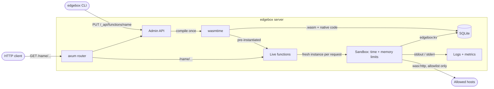

# edgebox

[](https://github.com/Aryan-xo/edgebox/actions/workflows/ci.yml)

**A tiny serverless runtime for WebAssembly, written in Rust.** Think a self-hosted mini Cloudflare Workers: deploy a function, and edgebox serves every HTTP request from a **fresh, sandboxed instance**, in microseconds.

- ⚡ **26.8 µs** cold start per request, **~70k req/s** on one machine ([benchmarks](BENCHMARKS.md))
- 🔒 **Sandboxed:** per-request time and memory limits (even `loop {}` is stopped), no file or network access unless granted
- 🧩 **Any language:** standard `wasi:http` components; Rust and JavaScript examples included
- 🗄️ **Batteries included:** versioned hot deploys, a KV store, secrets, an outbound HTTP allowlist, logs, Prometheus metrics
- 📦 **One binary + SQLite.** Docker and Fly.io ready

```text
$ edgebox deploy hello http_hello.wasm
deployed hello v1 (130122 bytes) → http://127.0.0.1:8080/hello
$ curl localhost:8080/hello/world
Hello from WASM! You requested /hello/world
```

## Quickstart

```sh
rustup target add wasm32-wasip2
cargo guests                       # build the example functions to .wasm
cargo install --path crates/cli    # installs the `edgebox` binary

edgebox serve &                    # 127.0.0.1:8080, functions stored in edgebox.db
edgebox deploy hello target/wasm32-wasip2/release/http_hello.wasm
curl localhost:8080/hello/world
```

Or with Docker:

```sh
docker build -t edgebox .
docker run -p 8080:8080 -v edgebox-data:/data edgebox serve hello=/opt/edgebox/examples/http_hello.wasm
```

## How it works



1. A **function** is a [WASI component](https://component-model.bytecodealliance.org/) that exports `wasi:http/incoming-handler`.
2. **Deploying** compiles it with [wasmtime](https://wasmtime.dev), stores the `.wasm` and the native code in SQLite as a new version, and swaps it in live.
3. **Each request** gets a brand-new instance from a pre-instantiated template and a pooled memory slot. No state leaks between requests.
4. The instance can only reach what its config grants: its own KV namespace, its secrets, and its allowed hosts.

## Features

### Deploy and manage

| Command | What it does |
| --- | --- |
| `edgebox serve [NAME=PATH...]` | Start the server, optionally deploying files at startup |
| `edgebox deploy NAME PATH [--env K=V] [--allow-host H]` | Upload a new version; live immediately, no restart |
| `edgebox list` | Deployed functions and versions |
| `edgebox logs NAME` | A function's recent stdout/stderr |
| `edgebox run PATH [ARGS...]` | Run a CLI-style component locally |

<details>
<summary>Admin API</summary>

Set `EDGEBOX_TOKEN` on the server and client to require `Authorization: Bearer <token>`.

| Method | Path | |
| --- | --- | --- |
| `PUT` | `/_api/functions/{name}` | Deploy (`.wasm` body). Returns `{name, version, size, deployed_at}` |
| `GET` | `/_api/functions` | List latest versions |
| `DELETE` | `/_api/functions/{name}` | Delete all versions, config and KV data |
| `GET` / `PUT` | `/_api/functions/{name}/config` | `{"env": {...}, "allowed_hosts": [...]}`; secret values are never returned |
| `GET` | `/_api/functions/{name}/logs` | Last 200 stdout/stderr lines |
| `GET` | `/_api/metrics` | Prometheus metrics |
| `GET` | `/_health` | `ok` (no token needed) |

</details>

### What functions can use

Everything is off by default and granted per function.

| Feature | How | Example |
| --- | --- | --- |
| **KV store** | Import `edgebox:kv/store` ([`wit/kv.wit`](wit/kv.wit)). Durable, private to each function | [`counter`](examples/counter/src/lib.rs) |
| **Secrets** | Environment variables: `--env API_KEY=...` | [`fetch`](examples/fetch/src/lib.rs) |
| **Outbound HTTP** | Standard `wasi:http/outgoing-handler`, only to allowed hosts: `--allow-host api.example.com` | [`fetch`](examples/fetch/src/lib.rs) |

```sh
edgebox deploy counter target/wasm32-wasip2/release/counter.wasm
curl localhost:8080/counter      # You are visitor #1
curl localhost:8080/counter      # You are visitor #2

edgebox deploy fetch target/wasm32-wasip2/release/fetch.wasm --allow-host example.com
curl "localhost:8080/fetch?url=https://example.com/"   # works; any other host → 502
```

### Sandbox limits

| Limit | Default | Flag / env | On violation |
| --- | --- | --- | --- |
| Time per request | 10 s | `--timeout-ms` / `EDGEBOX_TIMEOUT_MS` | `504`, instance stopped |
| Memory per instance | 128 MiB | `--max-memory-mb` / `EDGEBOX_MAX_MEMORY_MB` | `500`, instance trapped |

Timeouts use wasmtime's **epoch interruption**, so even a tight `loop {}` that never yields is stopped. With `--timeout-ms 50`, an infinite loop returns 504 in ~52 ms and the CPU goes back to idle. Try it with [`examples/chaos`](examples/chaos/src/lib.rs).

### Any language

[`examples/js-hello`](examples/js-hello/app.js) is a JavaScript function built with [jco](https://github.com/bytecodealliance/jco):

```js
addEventListener("fetch", (event) =>
  event.respondWith(new Response("Hello from JavaScript!\n")),
);
```

```sh
npm --prefix examples/js-hello ci && npm --prefix examples/js-hello run build
edgebox deploy js target/wasm32-wasip2/release/js_hello.wasm
```

### Observability

| What | Where |
| --- | --- |
| Request log: function, method, path, status, duration | Server output; `--log-format json`, filter with `RUST_LOG` |
| A function's stdout/stderr | `edgebox logs NAME` |
| Requests by status, latency histogram, deployed functions | `GET /_api/metrics` (Prometheus) |

## Performance

Apple M4 Pro, release build:

| | |
| --- | --- |
| Cold start (fresh instance + handle a request) | **26.8 µs** |
| Throughput, `ab -k -c 50` | **~70k req/s**, p99 2–3 ms |
| Load a function on restart (cached native code) | **88 µs** (vs 8.7 ms compiling) |

The pooling allocator alone gave **2.8× the throughput**. Method and details are in [BENCHMARKS.md](BENCHMARKS.md), and the write-up is in [docs/blog](docs/blog/fresh-sandbox-per-request.md).

## Deploy

**Docker:** see [Quickstart](#quickstart). The image runs as an unprivileged user and keeps data in `/data`.

**Fly.io:** [`fly.toml`](fly.toml) is ready:

```sh
fly launch --copy-config --no-deploy --name <your-app>
fly volumes create edgebox_data --size 1
fly secrets set EDGEBOX_TOKEN=$(openssl rand -hex 32)
fly deploy
```

## Project layout

| Path | Purpose |
| --- | --- |
| [`crates/runtime`](crates/runtime/src/lib.rs) | wasmtime embedding: sandbox, limits, `wasi:http`, KV host, log capture |
| [`crates/server`](crates/server/src/lib.rs) | axum router, admin API, SQLite store, metrics |
| [`crates/cli`](crates/cli/src/main.rs) | The `edgebox` command |
| [`wit/`](wit/kv.wit) | The `edgebox:kv` interface offered to functions |
| [`examples/`](examples) | Example functions: Rust and JavaScript |

## Development

```sh
cargo guests && cargo test --workspace     # ~40 unit and integration tests
cargo bench -p edgebox-runtime             # cold-start benchmarks
```

## Roadmap

- [x] Run components from the CLI
- [x] HTTP functions over `wasi:http`
- [x] Versioned deploys with hot swap
- [x] Time and memory limits
- [x] Sub-millisecond cold starts
- [x] KV store, secrets, outbound allowlist
- [x] Logs, metrics, JavaScript functions
- [ ] Rollback to a previous version
- [ ] Per-function limits and rate limiting
- [ ] Custom domains and routing rules

## License

Licensed under either of [MIT](LICENSE-MIT) or [Apache-2.0](LICENSE-APACHE), at your option.
